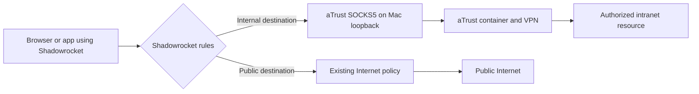
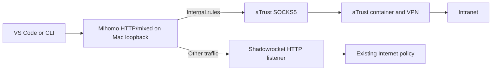

# aTrust In&Out

**aTrust Docker + Shadowrocket: reach your intranet and the public Internet from the same Mac.**

[简体中文](README.zh-CN.md) · [Setup](docs/setup.en.md) · [Troubleshooting](docs/scenarios.en.md) · [Agent deployment prompt](prompts/deploy.en.md)

A practical guide to reusing a containerized aTrust session, adding precise split-routing rules, and connecting browsers, IDEs, internal AI providers, GitLab, and SSH clients. Includes an optional Mihomo bridge for applications that need an explicit HTTP proxy.

This repository contains documentation, example configuration, and prompts. It does not ship VPN software, subscriptions, credentials, or a universal unattended installer. Your VPN must already authorize access to the destination; routing cannot grant access to a network the VPN does not expose. Use a deployment permitted by your organization.

## Start with your local agent

Download this repository through **Code → Download ZIP**, or clone it:

```sh
git clone https://github.com/Goodyzhang/atrust-shadowrocket-inout.git
cd atrust-shadowrocket-inout
```

Give a local agent with terminal and, when available, desktop access this instruction:

> Read `prompts/deploy.en.md` in this downloaded repository and execute it on this machine. Reuse the existing environment, ask only for missing inputs, make the necessary incremental changes, and verify the actual applications. Do not stop at writing a tutorial. Keep secrets and private reports outside this repository.

The [full prompt](prompts/deploy.en.md) covers discovery, new installation when needed, routing, acceptance, rollback, and a local handoff. It is usable with Codex, VS Code agents, Antigravity, Claude Code, or another capable local harness. A prompt cannot supply missing VPN credentials, approve MFA, or make a cloud-only agent control your Mac.

## 1. How it works

Suppose `192.168.50.20` is an internal office portal, `192.168.50.30:18080` is an internal model provider, and `192.168.50.40` is GitLab. These are **invented examples**. The VPN portal, for example `vpn.example.com`, is a separate endpoint supplied by your administrator.

The aTrust client runs inside a Linux container. After login, that container can reach the resources allowed by the VPN. Its SOCKS5 listener is published on the Mac's loopback interface, for example `127.0.0.1:1080`. An application connects to this local proxy and asks it to connect to the internal destination.

The internal IP does **not** become a local address, and `1080` is **not** an HTTP website or the model API port. It is the local entrance to a proxy path. Docker on macOS also involves a Linux VM; a container tunnel is not automatically a macOS route.

### Path A — let Shadowrocket split traffic



Add the local aTrust SOCKS5 endpoint as a Shadowrocket node. Route only verified internal IPs/domains to it. Preserve your existing public Internet nodes and rules. A rule for a private address must precede a broad LAN bypass or other rule that would capture it.

### Path B — add an explicit HTTP entry point for an application



Mihomo is optional. This arrangement gives an application one HTTP proxy while selecting different upstreams by destination. Keep Mihomo's TUN disabled in this design. The chain must end: **never point Shadowrocket's upstream back at Mihomo**. The application's `127.0.0.1` must be on this Mac; a remote extension host has a different loopback interface.

| Example listener | Role | Must be discovered locally |
| --- | --- | --- |
| `127.0.0.1:1080` | Published aTrust SOCKS5 | Yes: Docker mapping and protocol |
| `127.0.0.1:1082` | Existing Shadowrocket HTTP proxy | Yes: enablement and actual port |
| `127.0.0.1:7890` | Optional Mihomo HTTP/mixed proxy | Yes: free port and running process |
| `127.0.0.1:5901` | Optional container VNC login UI | Yes: image support and binding |

These are examples, not port discovery results for your machine. `COMPANY-VPN` is a policy name you create, not a built-in feature. Here it contains only the aTrust upstream, with no automatic direct or public-proxy fallback for internal TCP requests. This applies only to TCP requests entering the configured proxy. UDP, QUIC, WebRTC, system DNS and applications bypassing the proxy need separate validation.

## 2. What to prepare and how to deploy

| Component | Purpose |
| --- | --- |
| macOS, primarily Apple Silicon | Reference platform; other platforms need their own validation |
| [OrbStack](https://docs.orbstack.dev/) **or** [Docker Desktop](https://docs.docker.com/desktop/setup/install/mac-install/) | Linux container runtime; reuse the one already installed |
| An appropriate aTrust image | This guide's container example is specifically for [docker-easyconnect's aTrust image](https://github.com/docker-easyconnect/docker-easyconnect) |
| [Shadowrocket](https://apps.apple.com/us/app/shadowrocket/id932747118) | Existing public Internet routing and optional internal routing |
| Your administrator's VPN portal, account, MFA/certificate and resource grants | Enter privately into the supported login interface |
| curl; Git/OpenSSH when those scenarios are needed | Layered checks and application access |
| [Mihomo](https://wiki.metacubex.one/en/) — optional | Explicit HTTP proxy with per-destination upstreams |

Deployment order:

1. Inventory the existing runtime, image architecture, listeners, active Shadowrocket profile and app proxy settings. Back up only what will change.
2. Reuse the aTrust container and its login. For a new machine, adapt the [Compose example](examples/compose.yaml); keep state and credentials outside this checkout.
3. Prove that the aTrust SOCKS5 endpoint reaches one authorized target.
4. Add precise Shadowrocket rules, or the optional Mihomo bridge; do not install a second global TUN.
5. Verify the real browser, provider, Git or SSH workflow, then check that public Internet access still works.
6. Save a private local report with the effective route, versions, evidence and rollback steps.

Follow the commands and restart procedure in [the setup guide](docs/setup.en.md). Upstream container capabilities and ports are documented in [docker-easyconnect usage](https://github.com/docker-easyconnect/docker-easyconnect/blob/master/doc/usage.md); those details must not be assumed for a different image.

## 3. Debug by scenario

| Scenario | What to check | Guide |
| --- | --- | --- |
| OA with multiple portals | Redirect destinations, SSO, embedded frames, static hosts, WebSocket connections | [OA and SSO](docs/scenarios.en.md#oa-and-sso) |
| Internal LLM provider | Exact model IDs, endpoint convention, API key, streaming and client cancellation | [Internal model provider](docs/scenarios.en.md#internal-model-provider) |
| Internal GitLab | Separate HTTPS Git from SSH Git; scoped proxy settings and host verification | [GitLab and SSH](docs/scenarios.en.md#gitlab-and-ssh) |
| Public AI models missing | Account entitlement, actual destination rule, fresh model catalog and real response | [Public model catalog](docs/scenarios.en.md#public-model-catalog) |
| Claude missing/unusable in VS Code Copilot | Pro+ recognized but Upgrade still shown; rule correction, client update and real Opus/Sonnet tests | [Full repair case](docs/copilot-claude.en.md) |
| VPN connected but nothing works | Local listener → proxy handshake → container route → target TCP → app auth | [General diagnosis](docs/scenarios.en.md#general-diagnosis) |

`ping` alone is insufficient. A TLS handshake or an HTTP `401` establishes a different fact from a successful authenticated API call. `curl` success also does not prove that an IDE extension uses the same path.

**Copilot Claude repair record:** the [dedicated guide](docs/copilot-claude.en.md) covers the empty-window reproduction, changing `githubcopilot.com` from `DIRECT` to the existing Internet policy, VS Code proxy/version checks, and UI/log evidence for Opus 5.5 returning `OPUS_OK` and Sonnet 5.5 returning `SONNET_OK` on 2026-10-01. Routing and client versions both changed; the guide preserves that causal limit and gives an independent retest procedure.

## 4. Downloadable prompts and examples

| File | Use |
| --- | --- |
| [English deployment prompt](prompts/deploy.en.md) / [中文部署 prompt](prompts/deploy.zh-CN.md) | Hand the complete task to a local agent |
| [English maintenance prompt](prompts/maintain.en.md) / [中文维护 prompt](prompts/maintain.zh-CN.md) | Diagnose a later failure without rebuilding a working setup |
| [Copilot Claude prompt](prompts/copilot-claude.en.md) / [中文专项 prompt](prompts/copilot-claude.zh-CN.md) | Diagnose missing/Upgrade-only/failed models and verify real Opus and Sonnet responses |
| [Compose](examples/compose.yaml) + [private environment template](examples/atrust.env.example) | New aTrust container only; existing containers should be reused |
| [Shadowrocket rule fragment](examples/shadowrocket.rules.example) | Merge rules after defining the local SOCKS node; not a complete subscription/profile |
| [Mihomo example](examples/mihomo.example.yaml) | Optional application bridge; substitute measured ports and destinations |
| [VS Code settings fragment](examples/vscode-settings.example.json) | Merge into the appropriate user scope, preserving unrelated settings |
| [Acceptance template](docs/acceptance-template.md) | Private evidence and restart handoff, not a public diagnostics dump |

## Evidence and scope

This guide grew out of hands-on maintenance of a Mac with a running aTrust container, Shadowrocket and an optional Mihomo bridge. The source environment exercised internal AI text requests, streaming/cancellation, SSH/Git, and public Copilot model access. Actual endpoints and credentials are intentionally absent.

The public examples are newly sanitized templates. They have configuration checks, but have **not** been deployed against the invented addresses. OA multi-portal, private DNS and fresh-install variations are diagnostic recipes, not claims that every enterprise deployment works. In one model-catalog incident, a direct-route rule was changed and the client was also updated/restarted before recovery; that evidence does not isolate a single universal cause.

No automatic monitoring or unattended MFA recovery is implied. Containers restarting and VPN sessions becoming valid are separate events.

## Sources and license

See [upstream references and validation boundaries](docs/references.md). Use the application UI to change Shadowrocket configuration; do not patch its live private database. This project is independent of Sangfor, Shadowrocket, Docker, OrbStack and MetaCubeX.

[MIT](LICENSE) covers this repository's original documentation, prompts and examples. Third-party software retains its own license. Keep real endpoints, exported subscriptions, keys, login-state directories and raw logs out of public issues and commits.
