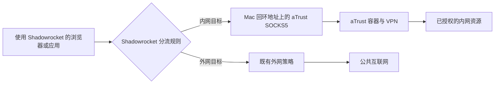
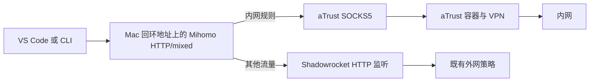

# aTrust In&Out

**aTrust Docker + Shadowrocket：让同一台 Mac 同时访问内网与外网。**

[English](README.md) · [布置步骤](docs/setup.zh-CN.md) · [场景排障](docs/scenarios.zh-CN.md) · [交给 agent 的部署 prompt](prompts/deploy.zh-CN.md)

这份教程介绍如何复用容器中的 aTrust 登录状态，增量配置内外网分流，让浏览器、IDE、内网大模型 provider、GitLab 和 SSH 使用合适的链路。对于需要显式 HTTP 代理的应用，另提供可选的 Mihomo 本地入口。

仓库只提供文档、示例配置和 prompt，不附带 VPN 软件、订阅、凭据或适用于所有公司的无人值守安装器。目标必须在 VPN 已授权的资源范围内；本地分流不能创造 VPN 尚未提供的访问权限。使用前确认组织允许这种部署方式。

## 直接交给本地 agent

点击 **Code → Download ZIP** 下载，或克隆仓库：

```sh
git clone https://github.com/Goodyzhang/atrust-shadowrocket-inout.git
cd atrust-shadowrocket-inout
```

向具备终端、必要时具备桌面操作能力的本地 agent 发送：

> 请完整读取下载仓库中的 `prompts/deploy.zh-CN.md`，在本机实际执行。复用已有环境，只询问缺失信息，增量配置并完成应用层验收，不要只给教程。所有凭据和私有报告保存在仓库之外。

[完整 prompt](prompts/deploy.zh-CN.md) 包含环境发现、必要时从零安装、分流、验收、回滚和本地交接要求。Codex、VS Code agent、Antigravity、Claude Code 或其他有本地工具权限的 harness 均可按同一流程执行。VPN 凭据、MFA 和本机操作权限仍需用户提供；云端纯聊天 agent 无法仅凭 prompt 控制你的 Mac。

## 1. 原理

例如，`192.168.50.20` 是内网 OA，`192.168.50.30:18080` 是内网模型 provider，`192.168.50.40` 是 GitLab。**这些地址全部是虚构示例**。用于登录 VPN 的门户，例如 `vpn.example.com`，是另一项需要管理员提供的信息。

aTrust 在 Linux 容器中登录后，容器可以访问 VPN 允许的资源。把容器的 SOCKS5 端口发布到 Mac 的回环地址，例如 `127.0.0.1:1080`，本机应用就能连接这个代理入口，请它访问内网目标。

内网 IP 并没有变成本机地址；`1080` 也不是 OA 网页或模型 API 的端口。它只是本机监听的代理入口。macOS 的 Docker 还经过 Linux 虚拟机，因此“容器内出现隧道路由”不能直接证明“Mac 已获得相同路由”。

### 接法 A：由 Shadowrocket 分流



在 Shadowrocket 中新增一个指向本地 aTrust SOCKS5 的节点，只把实测可达的内网 IP/域名分配给它。保留现有外网节点与规则；内网精确规则应排在会抢先匹配的 LAN 绕过规则之前。

### 接法 B：为应用增加显式 HTTP 入口



Mihomo 是可选项。这种接法让应用只配置一个 HTTP 代理，由 Mihomo 按目标选择上游。在这个方案中关闭 Mihomo TUN，**不要再把 Shadowrocket 的上游指回 Mihomo**。如果请求由 Remote SSH 扩展宿主或容器发出，那里看到的 `127.0.0.1` 并不指向这台 Mac。

| 示例监听地址 | 作用 | 是否必须现场确认 |
| --- | --- | --- |
| `127.0.0.1:1080` | aTrust 容器发布的 SOCKS5 | 是，检查 Docker 映射与协议 |
| `127.0.0.1:1082` | Shadowrocket 已有 HTTP 入口 | 是，确认已启用及实际端口 |
| `127.0.0.1:7890` | 可选 Mihomo HTTP/mixed 入口 | 是，检查端口占用与进程 |
| `127.0.0.1:5901` | 可选容器 VNC 登录界面 | 是，确认镜像支持及绑定范围 |

端口表是示例，不能直接当作你机器的探测结果。`COMPANY-VPN` 是需要创建的策略名。本教程让它只包含 aTrust 上游，内网 TCP 请求不自动回退到直连或外网节点。范围仅限进入该代理的 TCP 请求；UDP、QUIC、WebRTC、系统 DNS 和绕过代理的应用需要单独验收。

## 2. 软件准备与布置顺序

| 准备项 | 用途 |
| --- | --- |
| macOS，主要参考 Apple Silicon | 其他平台需独立验证 |
| [OrbStack](https://docs.orbstack.dev/) 或 [Docker Desktop](https://docs.docker.com/desktop/setup/install/mac-install/) | Linux 容器运行时，复用已有的一种即可 |
| 适合目标门户的 aTrust 镜像 | 本仓库容器示例仅对应 [docker-easyconnect 的 aTrust 镜像](https://github.com/docker-easyconnect/docker-easyconnect) |
| [Shadowrocket](https://apps.apple.com/us/app/shadowrocket/id932747118) | 保留已有外网接入，并按需增加内网分流 |
| 管理员提供的门户、账号、MFA/证书与资源权限 | 在受支持的登录界面私下输入 |
| curl；按场景准备 Git/OpenSSH | 分层探测及应用接入 |
| [Mihomo](https://wiki.metacubex.one/)（可选） | 为应用提供按目标分流的 HTTP 代理 |

执行顺序：

1. 发现已有运行时、镜像架构、监听端口、Shadowrocket 生效配置和应用代理设置，备份将修改的部分。
2. 复用 aTrust 容器和登录。新机才适配 [Compose 示例](examples/compose.yaml)；状态与凭据保存在 checkout 之外。
3. 通过 aTrust SOCKS5 实测一个已授权内网目标。
4. 添加精确 Shadowrocket 规则，或可选的 Mihomo 入口，避免叠加第二个全局 TUN。
5. 实际验证浏览器、模型 provider、Git 或 SSH，再回归外网访问。
6. 把实际链路、版本、证据和回滚办法写入本地私有报告。

具体命令与重启顺序见[布置指南](docs/setup.zh-CN.md)。镜像的服务、端口和登录方式以 [docker-easyconnect usage](https://github.com/docker-easyconnect/docker-easyconnect/blob/master/doc/usage.md) 为依据；其他镜像不能套用同一组参数。

## 3. 按场景调试

| 场景 | 核对重点 | 文档 |
| --- | --- | --- |
| OA 多门户 | 跳转目标、SSO、iframe、静态资源、WebSocket | [OA 与 SSO](docs/scenarios.zh-CN.md#oa-与-sso) |
| 内网大模型 provider | 完整模型 ID、端点约定、Key、流式与客户端取消 | [内网模型-provider](docs/scenarios.zh-CN.md#内网模型-provider) |
| 内网 GitLab | HTTPS Git 与 SSH Git 分开配置，限制作用范围并核对主机键 | [GitLab-与-SSH](docs/scenarios.zh-CN.md#gitlab-与-ssh) |
| 外网 AI 模型缺失 | 订阅权限、实际规则命中、刷新目录和真实回答 | [外网模型目录](docs/scenarios.zh-CN.md#外网模型目录) |
| VPN 已登录但不通 | 本地监听 → 代理握手 → 容器路由 → 目标 TCP → 应用认证 | [通用诊断](docs/scenarios.zh-CN.md#通用诊断) |

仅有 `ping` 结果不足以下结论。TLS 握手成功、HTTP `401`、认证后的 API 成功分别证明不同层次；`curl` 成功也不能替代 IDE 扩展的实际调用。

## 4. 可下载的 prompt 与示例

| 文件 | 用途 |
| --- | --- |
| [中文部署 prompt](prompts/deploy.zh-CN.md) / [English deployment prompt](prompts/deploy.en.md) | 完整交给本地 agent 执行 |
| [中文维护 prompt](prompts/maintain.zh-CN.md) / [English maintenance prompt](prompts/maintain.en.md) | 后续故障诊断，保留可用环境 |
| [Compose](examples/compose.yaml) + [私有环境模板](examples/atrust.env.example) | 仅用于新建容器；已有容器优先复用 |
| [Shadowrocket 规则片段](examples/shadowrocket.rules.example) | 先定义本地 SOCKS 节点，再合并规则，不是完整订阅或配置 |
| [Mihomo 示例](examples/mihomo.example.yaml) | 可选应用入口，须替换为实测端口与目标 |
| [VS Code 设置片段](examples/vscode-settings.example.json) | 增量合并到正确的用户作用域，保留其他设置 |
| [验收模板](docs/acceptance-template.md) | 本地私有证据与重启交接，不用于公开倾倒诊断信息 |

## 证据与适用范围

教程来自一台 Mac 的实际维护：已有 aTrust 容器、Shadowrocket，以及按应用使用的 Mihomo 入口。原环境执行过内网模型文本、流式与取消、SSH/Git 和外网 Copilot 模型访问验收。真实地址和凭据均不随教程发布。

公开示例是重新编写的脱敏模板，做了配置校验，**没有对这些虚构地址做真实部署**。OA 多门户、企业 DNS 和从零安装部分提供排障方法，不代表所有企业环境都已测过。一次模型目录故障在调整直连规则并更新、重启客户端后恢复，无法据此把所有同类问题归结为某个单一原因。

教程不承诺无人值守 MFA 恢复或会话结束后的自动监听；容器自动启动与 VPN 登录重新有效是两件事。

## 参考与许可

见[上游资料及验证边界](docs/references.md)。Shadowrocket 配置通过应用界面修改，不直接写其运行中的私有数据库。本项目独立于深信服、Shadowrocket、Docker、OrbStack 与 MetaCubeX。

[MIT](LICENSE) 适用于本仓库原创文档、prompt 和示例；第三方软件遵循自身许可。真实端点、订阅导出、密钥、登录状态目录及原始日志不得进入公开 issue 或提交。
