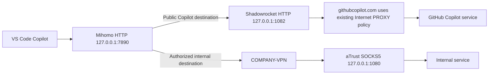

# Copilot Pro+ in VS Code, but Claude is unavailable: repair case and verification

[中文](copilot-claude.zh-CN.md) · [Home](../README.md) · [Dedicated agent prompt](../prompts/copilot-claude.en.md)

This case records an actual repair on **2026-10-01, Asia/Shanghai**, documented on 2026-10-03. The final VS Code Copilot setup produced real responses from **Claude Opus 5.5** and **Claude Sonnet 5.5**. Model names and versions describe that observation; they do not promise availability for every account today or require installing historical versions.

Relevant symptoms: an active subscription, the target model working on another machine, but Claude missing locally, an upgrade entry instead of a usable model, or a failed request after selection. Observations, changes and verification limits are separated below. Actual company endpoints, account details, proxy subscriptions and raw logs remain private.

## 1. What was observed before the repair

| Item | Observation | Supported conclusion |
| --- | --- | --- |
| User report | Opus worked on other machines but not this one | Compare local configuration; those other machines were not individually retested in this session |
| Local subscription | The Copilot extension recognized Pro+ | An upgrade prompt alone was insufficient reason to repurchase; current model entitlement still needed checking |
| Client | VS Code `1.139.1`, Copilot `0.67.0` | The version combination during the failure was recorded |
| Empty-window reproduction | The issue remained after opening and reloading a window without a project | This symptom did not depend on the original project's code or workspace settings |
| Catalog and UI | Fresh available-model metadata excluded Claude; the picker still exposed a Sonnet 5 `Upgrade` entry | An upgrade entry was not evidence that the model could be used |
| Shadowrocket rule test | `api.individual.githubcopilot.com` matched `DOMAIN-SUFFIX,githubcopilot.com,DIRECT` | An actual Copilot destination was assigned to the direct policy; that route needed examination |

Recognizing Pro+, refreshing the model catalog and completing a response with a particular Claude model are three separate acceptance checks. Opening GitHub in a browser or logging into the company VPN does not replace the last check.

The investigation identified a routing choice to correct, but did not complete a successful generation test with only that change while keeping the old client. These observations do not establish that direct connections always fail or that an old client causes every similar symptom.

## 2. The final working network path



These loopback ports come from that case and must be rediscovered on another machine. Mihomo sent public Copilot destinations to `Existing-Shadowrocket`; company targets retained their `COMPANY-VPN` path. An HTTP bridge for VS Code already existed. The repair did not add another VPN or global TUN.

The test used Copilot's own model menu and GitHub sign-in, without supplying a separate Anthropic API key. Custom providers/BYOK are a different configuration and should not be confused with Copilot subscription entitlement.

## 3. What actually changed

### 3.1 Correct one rule in the active Shadowrocket configuration

The rule test identified this existing match:

```text
DOMAIN-SUFFIX,githubcopilot.com,DIRECT
```

Using Shadowrocket's supported UI, the policy on **that same rule** was changed to the existing Internet policy:

```text
DOMAIN-SUFFIX,githubcopilot.com,PROXY
```

`PROXY` was an already defined, usable policy in this environment. Select your own verified Internet policy. Back up the active profile, edit and save, then check the effective match again. Preserve unrelated rules, subscriptions, internal routing and login state.

This is neither Copilot's complete destination list nor an instruction to append the rule to every setup. Earlier matches, bypass lists or different request hosts can still affect the result. Check observed connections against the [official Copilot allowlist](https://docs.github.com/en/copilot/reference/copilot-allowlist-reference). Do not route all of GitHub or all private networks through one policy indiscriminately.

### 3.2 Verify VS Code's explicit proxy entry point

The environment already used the following effective settings. On another machine, open `Preferences: Open User Settings (JSON)` from the Command Palette, confirm the active profile/execution location, and **merge only the needed fields**. `settings.json` is JSONC; avoid whole-file conversions that discard comments or unrelated settings.

```json
{
  "http.proxy": "http://127.0.0.1:7890",
  "http.proxySupport": "override",
  "http.proxyStrictSSL": true
}
```

Use the measured local HTTP/mixed listener; the aTrust SOCKS port is not an HTTP entry point. `http://` describes the local proxy protocol; the GitHub destination still uses HTTPS/TLS verification. See [Copilot's official network configuration](https://docs.github.com/en/copilot/how-tos/copilot-in-your-ide/set-up-copilot/configure-network-settings).

Do not assume `override` makes every extension follow the same path. Confirm Copilot's actual connections in the client and proxy. A Remote SSH/container extension host's `127.0.0.1` also does not refer to this Mac. Preserve `http.proxyStrictSSL: true`; a hidden certificate failure is not a successful connection.

### 3.3 Client update, restart and catalog refresh

When desktop interaction resumed, the client had also been updated and restarted to VS Code `1.140.0` / Copilot `0.68.0`. Fresh windows fetched model metadata, and Claude models appeared again.

The repair did not change the subscription tier, fabricate model entitlement, erase the authentication database or disable certificate checks. Both routing and client versions changed before the successful final test, so the evidence establishes **a working final combination**. No single-variable rollback experiment was performed, and the recovered environment was not disrupted merely to isolate causality.

## 4. Were Opus and Sonnet actually reachable afterward?

**Both real generation tests passed in that session.** They ran in Ask mode in a separate window with no project, using only minimal text requests and no project-file reads or uploads.

| Time (2026-10-01, Asia/Shanghai) | Check | Result and evidence |
| --- | --- | --- |
| 09:45 | Refresh model catalog | Fresh metadata included Opus 5.5, Sonnet 5.5, Sonnet 5 and others; both empty and project windows recorded successful catalog retrieval |
| 09:47:29 | Claude Opus 5.5 | UI returned `OPUS_OK`; extension recorded `success`, model mapping `claude-opus-5.5 → claude-opus-5-5`, recorded duration `2285 ms` |
| 09:48:20 | Claude Sonnet 5.5 | UI returned `SONNET_OK`; extension recorded `success`, model mapping `claude-sonnet-5.5 → claude-sonnet-5-5`, recorded duration `2608 ms` |

Mihomo connection records at 09:45 and 09:47 showed Code Helper accessing `api.individual.githubcopilot.com` through `Existing-Shadowrocket`. The corresponding Shadowrocket domain policy was `PROXY`. No separate public egress-IP observation was collected for those generation requests, so the case does not identify an exit address or region.

Recorded single-request durations help correlate evidence; they are not a performance benchmark, uptime measure or promise of future latency. Other Claude versions were observed in the catalog without individual generation tests. These two text requests did not validate tools, long context, images or long-running tasks.

An unauthenticated regression probe of the existing internal model route returned `401`, establishing arrival at an authentication boundary. Its full authenticated model workflow was not repeated during this repair. Fixing Copilot did not require changing the company provider or aTrust login.

These facts were checked against the maintenance report, structured evidence and original generation logs. The public page contains only necessary sanitized facts, without raw logs, request identifiers, private profiles or complete backups. Preparing this documentation on 2026-10-03 did not make new model calls.

## 5. Reproduce the diagnosis and acceptance on your machine

### Step 1: Preserve symptom and account evidence

Confirm the account actually signed into VS Code, the Copilot plan, organization policy, model entitlement and usage limits. Record VS Code/Copilot versions and reproduce once in an empty window. Distinguish a missing catalog entry, an Upgrade entry and a selectable model whose request fails. [Current supported models](https://docs.github.com/en/copilot/reference/ai-models/supported-models) and entitlement can change; do not copy this case's model names or purchasing conclusions blindly.

### Step 2: Identify the listener, destination and rule

Check the listener's process, effective application proxy scope and actual Copilot request host. Run Shadowrocket's rule test for the observed domain. With Mihomo, also verify its selected upstream. Following [Copilot's logging guidance](https://docs.github.com/en/copilot/how-tos/troubleshoot-copilot/view-logs), inspect the relevant time interval in VS Code Output's GitHub Copilot / GitHub Copilot Chat channels; names depend on the installed version. Do not publish tokens, cookies, full request bodies or raw diagnostic bundles.

When needed, make bounded requests to an official diagnostic endpoint. Proxy ports below are examples:

```sh
# Application proxy; no GitHub token and no TLS-verification bypass.
curl --noproxy '' --proxy http://127.0.0.1:7890 \
  --connect-timeout 5 --max-time 15 -sS -o /dev/null \
  -w 'http=%{http_code} tls=%{ssl_verify_result}\n' \
  https://api.githubcopilot.com/_ping

# Check this layer separately if a Shadowrocket HTTP listener already exists.
curl --noproxy '' --proxy http://127.0.0.1:1082 \
  --connect-timeout 5 --max-time 15 -sS -o /dev/null \
  -w 'http=%{http_code} tls=%{ssl_verify_result}\n' \
  https://api.githubcopilot.com/_ping
```

This probe follows [official network troubleshooting](https://docs.github.com/en/copilot/how-tos/troubleshoot-copilot/troubleshoot-network-errors); it does not replace other hosts observed in the real request. Check curl's exit status and HTTP/TLS results. A successful `_ping` does not establish Claude entitlement or generation; an unauthenticated `400/401/403` also cannot decide model availability. Diagnose proxy protocol, VPN, TLS, authentication and model authorization separately.

### Step 3: Make evidence-based changes and retest

Modify relevant rules only when the current path requires correction. Check the active profile, order and bypasses; save and retest the affected request. When client/extension compatibility needs attention, update through official channels, save work and reload an idle window or restart the application. Prefer a retest after each change. If several variables change together, retain that causal limit in the report. Do not erase all settings or repeatedly reinstall the environment.

### Step 4: Require actual Claude responses

In a window without a project, disable file/workspace attachments. Select an Opus model actually available to the account and send “Reply only with `OPUS_OK`”; select the intended Sonnet and send “Reply only with `SONNET_OK`.” Requests count toward account usage; keep this to one minimal test per model. Correlate the selected model, UI reply and same-time log identity/success status. The returned string alone cannot identify a model.

Finally, recheck a required public site and an existing internal target. Record PASS / FAIL / NOT RUN. There is no need to call every company model, and an unauthenticated probe must be labeled as transport-only verification. Save actual ports, changes, versions, time, model IDs, log status and rollback outside the checkout in a private report.

## 6. Rollback and recurrence

Preserve the exact previous rule and setting values. Roll back only the change made: in this case the rule could be restored from `PROXY` to `DIRECT`, but doing so may restore the original symptom and is not a routine step. Do not replace a user's later changes with an entire old backup.

If Claude disappears again, check whether the active profile changed, subscription refresh replaced a rule, a listener moved, or the client refreshed its catalog. Then verify account → path → catalog → actual generation. Unresolved entitlement or service-side restrictions belong with the relevant administrator/service support; this case does not solve every cause.

To have a local agent perform the work, use the [dedicated prompt](../prompts/copilot-claude.en.md). It requires current discovery, scoped repairs and real acceptance instead of treating this historical pass as a pass on your machine.
