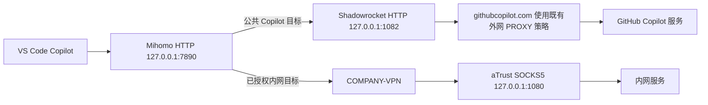

# VS Code Copilot 已有 Pro+，Claude 仍不可用：修复案例与复现步骤

[English](copilot-claude.en.md) · [首页](../README.zh-CN.md) · [专项 agent prompt](../prompts/copilot-claude.zh-CN.md)

本案例记录 **2026-10-01，Asia/Shanghai** 的一次实际修复，文档整理于 2026-10-03。最终在 VS Code Copilot 中分别取得了 **Claude Opus 5.5** 与 **Claude Sonnet 5.5** 的真实响应。型号与版本是当日观察记录，不是对所有账号当前可用性的承诺，也不要求读者安装这些历史版本。

适用症状：订阅有效、其他机器能使用目标模型，本机却看不到 Claude、只显示升级入口，或选择后无法调用。下面分开记录已观察事实、实际变更及验证边界；真实公司地址、账号、代理订阅和原始日志均不公开。

## 1. 修复前发现了什么

| 项目 | 当时观察 | 能得出的结论 |
| --- | --- | --- |
| 用户反馈 | 其他机器可以调用 Opus，本机不能 | 值得比较本机配置；本轮没有逐台复测其他机器 |
| 本机订阅 | Copilot 扩展已识别 Pro+ | 不能只凭升级提示就要求重新购买；仍需核对当前模型权限 |
| 客户端 | VS Code `1.139.1`，Copilot `0.67.0` | 记录故障时的版本组合 |
| 空白窗口复现 | 新建无项目窗口并重新加载后，问题仍存在 | 该症状不依赖原项目的代码或工作区配置 |
| 模型目录与界面 | 新获取的可用模型元数据未包含 Claude；选择器仍显示 Sonnet 5 的 `Upgrade` 入口 | 升级入口可见不等于该模型已可用 |
| Shadowrocket 规则测试 | `api.individual.githubcopilot.com` 命中 `DOMAIN-SUFFIX,githubcopilot.com,DIRECT` | 实际 Copilot 请求目标被分配到直连策略，需要核对这条路径 |

Pro+ 被识别、模型目录成功刷新、某个 Claude 模型完成回答，是三个不同的验收项目。浏览器能打开 GitHub、公司 VPN 已登录，也都不能替代最后一项。

这里发现了一个需要纠正的分流选择，但当时没有完成“只改路由、保持旧客户端不变”的成功生成对照。不能从上述观察断言直连必然失败，也不能把所有同类症状归结为旧客户端。

## 2. 最终可用的网络链路



这些 loopback 端口来自该次记录，在另一台机器上必须重新探测。Copilot 公共目标在 Mihomo 中使用 `Existing-Shadowrocket`；公司目标保留原有 `COMPANY-VPN` 路径。既有桥接已能为 VS Code 提供 HTTP 入口，本次修复没有另加一套 VPN 或全局 TUN。

本案例使用 Copilot 自己的模型菜单和 GitHub 登录，没有为 Claude 另填 Anthropic API Key。自定义 provider/BYOK 属于另一种配置，不应与 Copilot 订阅权限混为一项。

## 3. 实际修改了什么

### 3.1 在活动配置中修正一条 Shadowrocket 规则

规则测试明确命中以下旧规则：

```text
DOMAIN-SUFFIX,githubcopilot.com,DIRECT
```

通过 Shadowrocket 官方界面，将**同一条规则**的策略改为已有外网策略：

```text
DOMAIN-SUFFIX,githubcopilot.com,PROXY
```

`PROXY` 是该环境已有且可用的策略名，读者应选自己已经定义的外网策略。先备份活动配置，再编辑并保存，重新查看目标实际命中。保留其他规则、订阅、公司内网分流和登录状态。

这不是 Copilot 完整域名清单，也不是向所有配置无条件追加该规则的建议。其他更早命中的规则、绕过列表或不同请求域名仍可能影响结果；按实际连接和 [GitHub 官方 allowlist](https://docs.github.com/en/copilot/reference/copilot-allowlist-reference)核对。不要把整个 GitHub 或所有私网地址都改到同一路径。

### 3.2 核对 VS Code 的显式代理入口

该环境已有如下生效设置。其他机器应在命令面板打开 `Preferences: Open User Settings (JSON)`，确认当前 profile/执行位置，然后**合并需要的字段**；`settings.json` 是 JSONC，不要用会丢弃注释或覆盖其他设置的整文件转换。

```json
{
  "http.proxy": "http://127.0.0.1:7890",
  "http.proxySupport": "override",
  "http.proxyStrictSSL": true
}
```

这里填写本机 HTTP/mixed 入口，不能把 aTrust SOCKS 端口当作 HTTP 入口填入。`http://` 指本机代理协议，访问 GitHub 时仍保留目标 HTTPS/TLS 校验。代理设置方式参考 [Copilot 官方网络配置](https://docs.github.com/en/copilot/how-tos/copilot-in-your-ide/set-up-copilot/configure-network-settings)。

不要认为 `override` 会让每个扩展必然采用同一路径。以 Copilot 与代理的实际连接记录确认；Remote SSH、容器或其他远程扩展宿主中的 `127.0.0.1` 也不代表这台 Mac。保留 `http.proxyStrictSSL: true`，不把证书错误隐藏成连接成功。

### 3.3 客户端更新、重启与目录刷新

后续恢复桌面操作时，客户端已更新并重启为 VS Code `1.140.0` / Copilot `0.68.0`。新窗口重新获取模型元数据，Claude 模型重新出现在列表中。

本次没有更改订阅档位、伪造模型权限、删除整个认证数据库或关闭证书校验。由于路由与客户端版本都在最终成功验收前变化，证据只支持**最终组合有效**。没有进行回退到故障配置的单变量实验，也没有为补做因果实验中断已恢复的环境。

## 4. 修复后 Opus、Sonnet 实际可达吗

**当次两项真实生成均通过。**测试在独立无项目窗口的 Ask 模式中进行，仅发送最小文本请求，没有读取或上传项目文件。

| 时间（2026-10-01，Asia/Shanghai） | 检查 | 结果与证据 |
| --- | --- | --- |
| 09:45 | 刷新模型目录 | 新目录成功取得，包含 Opus 5.5、Sonnet 5.5、Sonnet 5 等；空白窗口与项目窗口均有目录刷新成功记录 |
| 09:47:29 | Claude Opus 5.5 | UI 返回 `OPUS_OK`；扩展记录 `success`，模型映射 `claude-opus-5.5 → claude-opus-5-5`，记录耗时 `2285 ms` |
| 09:48:20 | Claude Sonnet 5.5 | UI 返回 `SONNET_OK`；扩展记录 `success`，模型映射 `claude-sonnet-5.5 → claude-sonnet-5-5`，记录耗时 `2608 ms` |

09:45 与 09:47 的 Mihomo 连接记录显示，Code Helper 对 `api.individual.githubcopilot.com` 的访问走 `Existing-Shadowrocket`。对应 Shadowrocket 域名策略已为 `PROXY`。当次没有另外采集生成请求的公网出口 IP，因此不声称确定了出口地址或地区。

单次日志耗时仅用于对应请求证据，不是性能基准、持续可用率或未来响应时间承诺。其他 Claude 版本只确认目录可见，没有逐一生成；工具调用、长上下文、图像和长任务也未因这两次文本测试而获得验收。

公司内网模型路径做了不带凭据的回归探测，返回 `401`，说明到达认证边界；当次没有重复它的完整已认证模型测试。本案例的 Copilot 修复不要求修改公司 provider 或 aTrust 登录。

以上结论回读自维护报告、结构化证据与原始生成日志；公开页面只保留必要的脱敏事实，不附带原始日志、请求标识、私有 profile 或完整备份。2026-10-03 的文档整理没有再次调用模型。

## 5. 在自己的机器上复现诊断与验收

### 第一步：保留症状和账号证据

确认 VS Code 实际登录账号、Copilot 套餐、组织策略、模型权限和用量限制。记录 VS Code/Copilot 版本，在空白窗口复现一次，分别记录“目录没有”“只有 Upgrade”“可选但调用失败”。[当前支持模型](https://docs.github.com/en/copilot/reference/ai-models/supported-models)及权限可能变化，不照抄本案例的型号或购买结论。

### 第二步：确认入口、目标与规则

检查实际端口的监听进程、应用代理生效范围，以及 Copilot 请求的实际目标。对观察到的域名做 Shadowrocket 规则测试；若使用 Mihomo，同时核对它选择的上游。根据 [Copilot 日志指导](https://docs.github.com/en/copilot/how-tos/troubleshoot-copilot/view-logs)，在 VS Code Output 的 GitHub Copilot / GitHub Copilot Chat 通道检查相关时间段；通道名称以安装版本为准。不要公开 token、Cookie、完整请求正文或原始诊断包。

必要时对官方诊断端点执行有限请求，以下代理端口仅为示例：

```sh
# 应用代理入口；不携带 GitHub token，不关闭 TLS 校验。
curl --noproxy '' --proxy http://127.0.0.1:7890 \
  --connect-timeout 5 --max-time 15 -sS -o /dev/null \
  -w 'http=%{http_code} tls=%{ssl_verify_result}\n' \
  https://api.githubcopilot.com/_ping

# 若已有 Shadowrocket HTTP 入口，单独检查这一层。
curl --noproxy '' --proxy http://127.0.0.1:1082 \
  --connect-timeout 5 --max-time 15 -sS -o /dev/null \
  -w 'http=%{http_code} tls=%{ssl_verify_result}\n' \
  https://api.githubcopilot.com/_ping
```

这是按[官方网络排障](https://docs.github.com/en/copilot/how-tos/troubleshoot-copilot/troubleshoot-network-errors)选取的探测入口，不能替代实际观察到的其他主机。检查 curl 退出码及 HTTP/TLS 结果；`_ping` 成功不能证明 Claude 权限或生成成功，未认证请求的 `400/401/403` 也不能直接裁决模型可用性。代理协议、VPN、TLS、认证与模型授权失败分别处理。

### 第三步：针对证据修改并重测

只在当前路径确有问题时修改相关规则。核对活动 profile、顺序和 bypass，保存后先重测受影响请求。客户端版本或扩展兼容需处理时，通过官方渠道更新，保存工作后重载空闲窗口或重启应用。尽量每改一项就重测；多项同时变化时，在报告中保留归因限制。不清空全部设置，不反复重装环境。

### 第四步：用真实 Claude 回答验收

在无项目窗口中关闭文件/工作区附带，选择当前账号实际可用的目标 Opus，发送“只回复 `OPUS_OK`”；再选择目标 Sonnet，发送“只回复 `SONNET_OK`”。模型请求会计入账号用量，保持每个模型一次最小测试。结合选中模型、UI 回答和同时间日志中的模型身份/成功状态判断，不能只凭返回字符串认定模型身份。

最后回归一个需要的外网站点和已有内网目标，记录 PASS / FAIL / NOT RUN。没有必要完整调用所有公司模型，且未带认证的检查应明确写成仅网络层验收。将实际端口、改动、版本、时间、模型 ID、日志状态和回滚办法保存到仓库外的私有报告。

## 6. 回滚与复发处理

保留修改前的精确规则和设置。需回滚时只恢复本次改动：本案例的规则回滚是把该条 `PROXY` 恢复为 `DIRECT`，但它可能重新引入原症状，不应作为日常操作。不要用整份旧备份覆盖用户之后的变更。

再次缺失 Claude 时，先核对活动配置是否切换、订阅更新是否覆盖规则、监听端口是否变化，以及客户端是否刷新了目录。然后按账号 → 路径 → 目录 → 真实生成逐层核对。尚未证明的资源权限或服务端限制交给对应管理员/服务支持，不保证本案例能解决所有原因。

需要本地 agent 实际处理时，使用[专项 prompt](../prompts/copilot-claude.zh-CN.md)。它要求读取当前环境、做窄范围修复并验收，不会把本案例的通过记录当作读者机器已经通过。
